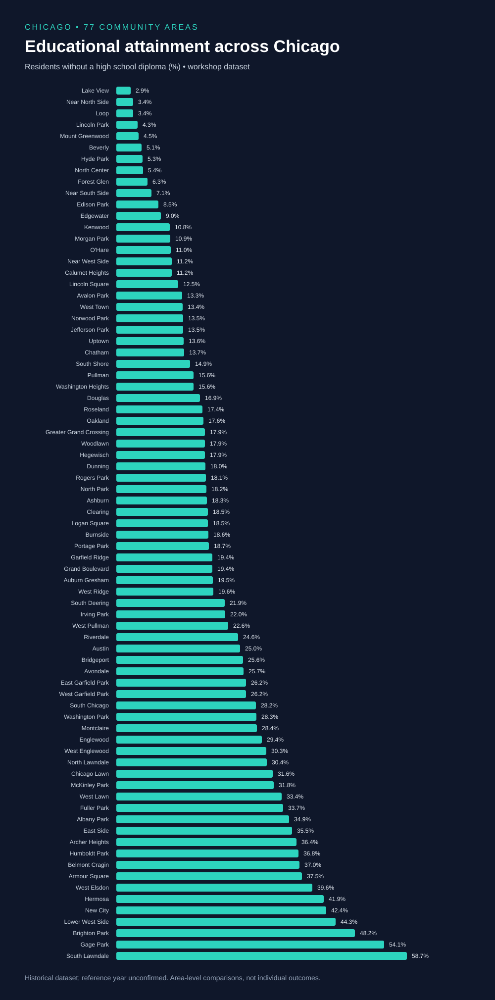

# Chicago Education Explorer

**A workshop project exploring educational attainment across Chicago's 77 community areas.**

Python · pandas · Seaborn · scikit-learn · Exploratory analysis · Decision trees

## The question

How does the percentage of residents without a high school diploma vary across Chicago community areas, and how does it relate to income, unemployment, and poverty?

## At a glance

| Measure | Result |
| --- | ---: |
| Community areas | 77 |
| Mean across areas | 21.60% |
| Median across areas | 18.50% |
| Lowest | Lake View · 2.9% |
| Highest | South Lawndale · 58.7% |
| Difference | 55.8 percentage points |

These are unweighted community-area statistics, not population-weighted citywide estimates.



## Workflow

1. Load and inspect the workshop CSV.
2. Summarize the educational-attainment variable.
3. Explore community differences and relationships using bar charts, scatterplots, and a boxplot.
4. Label areas as above or at/below the full-dataset mean.
5. Train a decision tree using income, unemployment, and poverty; evaluate on a 25% holdout.

The original notebook reported **95% accuracy: 19 correct predictions out of 20 test areas**. This is a recorded workshop result, not independently reproduced here. The polished notebook clears saved outputs and fixes the tree's random seed so its current results must be obtained by running it.

## Run locally

```bash
python -m venv .venv
# Windows: .venv\Scripts\activate
# macOS/Linux: source .venv/bin/activate
pip install -r requirements.txt
jupyter lab notebooks/chicago_education.ipynb
```

For Google Colab, upload the notebook and place the CSV at `data/chicago_dataset.csv` in the runtime. Run all cells from top to bottom.

## Repository guide

```text
assets/community-comparison.svg      # Chart generated from the supplied CSV
data/chicago_dataset.csv             # Workshop data, unchanged
notebooks/chicago_education.ipynb     # Edited analysis notebook
requirements.txt                    # Compatible dependency ranges
```

## Interpretation and limitations

- This is an introductory learning project using 77 aggregated observations. Associations do not establish causation or describe individual residents.
- The target label uses the full-dataset mean, including held-out areas. That reproduces the workshop's descriptive label definition; a predictive study should define its threshold in advance or from training data only.
- A single 20-area holdout provides an unstable estimate. Future work should include a majority-class baseline and repeated stratified validation; geographic dependence also deserves consideration.
- The supplied files do not establish the original dataset source, reference year, reuse terms, or complete data dictionary. Confirm these before public redistribution. Health indicators should not all be assumed to use percentage units.
- The notebook describes the education measure as adults aged 25 or older without a high school diploma; confirm against the original documentation.

## Workshop credit

Created by [Fariz Sarfaraz](https://github.com/farizxlancer45) as part of the Introduction to Data Science workshop at the University of Illinois Chicago on November 7, 2026, led by Gonzalo A. Bello. This repository distinguishes the original recorded result from subsequent presentation and reproducibility edits.

## Next steps

Confirm data provenance, add a baseline, evaluate across multiple splits, and explore feature importance without making causal claims.

